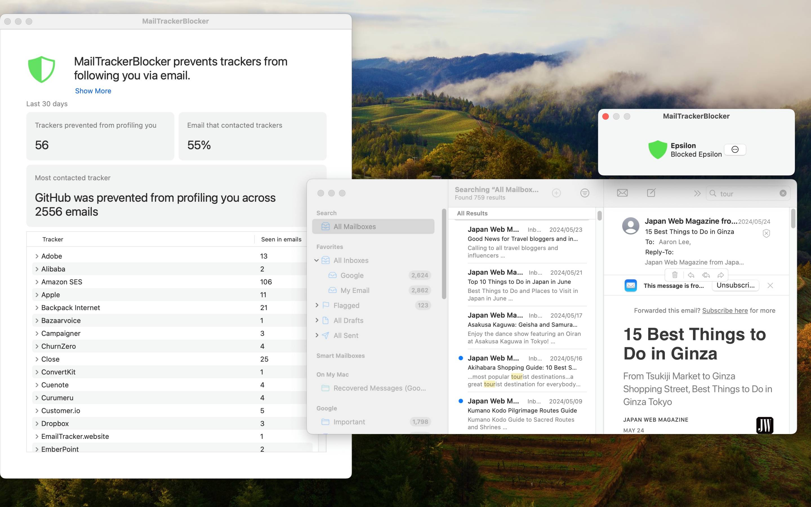
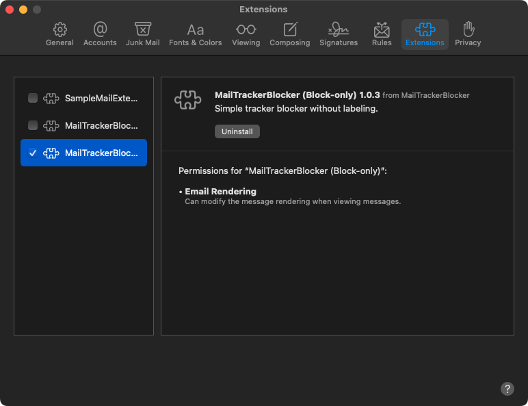

    

**MailTrackerBlocker** is an email tracker blocker for macOS Mail. Email marketers and other interests often embed invisible trackers in HTML emails so [they can track how often, when and where you open your emails](https://notospypixels.com/). Enable the included Mail Extension to find out who is tracking you and to block these spy pixels in your emails.

#### Available in the Mac App Store

#### Free Demo

Try out the beta for free by [enrolling on TestFlight](https://testflight.apple.com/join/cQLJpecQ)!

## Features

- Mail Extension: built specifically for macOS Mail.

- Privacy protection: Blocks most spy pixels which may capture your IP address and function as read receipts and more.

- Be informed: Identifies [over 300 of the most common email marketing vendors](https://github.com/apparition47/MailTrackerBlocker/blob/main/Source/MTBBlockedMessage.m#L212-L773).

- Tracker report: See a 30-day overview of blocked trackers in read emails along with some summary statistics.
  

## Requirements

- macOS 14.3 Sonoma or newer
  - Latest version of macOS recommended for bug fixes to Mail.
- Apple Mail
  - Note: Mail only allows up to one active `Message Security Extension` at a time. Set MailTrackerBlocker as your active Message Security Extension to unlock tracker reporting and unknown tracker blocking features.

## Usage

### How to enable the Mail Extension

1. Open the Mail app.
1. From the menu bar, open Settings > Extensions.
1. Check the `MailTrackerBlocker` extension to enable.
    * Mail allows only one active Message Security Extension at a time. If you have multiple installed, [select `MailTrackerBlocker` from the "Message security extension:" dropdown at the bottom](https://github.com/apparition47/MailTrackerBlockerApp/assets/3298414/26238241-fad6-42db-8141-17558aef8826) to enable tracker reporting and to block unknown trackers. These features won't be available if your Message security extension is set otherwise.
1. [Optional] Images are safe for viewing now so to re-enable them: Goto Mail > Settings > Privacy > disable "Block All Remote Content".

#### Which Mail Extension should I enable?

For the best experience, enable main `MailTrackerBlocker`.

However, if you experience issues with the main `MailTrackerBlocker` extension, try enabling only the `Block-only` extension. Similarly, if you need to use GPGMail, use `Block-only` instead of the `MailTrackerBlocker` extension. Due to bugs and API limitations currently in Mail so `Block-only` was created as a workaround for these issues. To summarize, use either:

| | **MailTrackerBlocker** (Message Security) | **Block-only** (Content Blocker) |
|---|---|---|
| Blocks known trackers | ✅ | ✅ |
| Shows what was blocked (header label + 30-day report + stats) | ✅ | ❌ |
| Blocks *unknown* trackers (heuristic blocking) | ✅ | ❌ |
| Can work with other Mail Security Extensions? | ❌ macOS allows only **one** Message Security extension | ✅ 

Both block the same trackers; the main extension adds the report and unknown-tracker detection via the Message Security API (slower, and macOS allows only one such extension active, so it can't run beside another one). Block-only uses the lightweight content-blocker API.

### How to view tracking reports

#### Message Labeler

In Mail, when selecting an email, a banner above the message panel if a tracker was detected. Or click the small ⓧ icon to view what trackers MailTrackerBlocker has detected.

#### Tracking Report

Open the MailTrackerBlocker app. The Tracking Report shows a rolling 30-day overview of e-mails grouped by tracker along with statistics.

## Known Issues

### [[FB12796974] Emails take a long time to load](https://github.com/apparition47/MailTrackerBlockerApp/issues/2)

Workaround: Try opening another email then going back. If you continue to have issues, disable the main Mail extension and try only the Content Blocker extension.

### [[FB22184388] Updating from Mac App Store gets stuck](https://github.com/apparition47/MailTrackerBlockerApp/issues/30)

Workaround: quit Mail then retry the update.

## FAQ

### Sometimes ⓧ icon missing even when enabled

See [`FB13801609`](https://github.com/apparition47/MailTrackerBlockerApp/issues/9) for workarounds.

### Does this work with Mail Privacy Protection?

Yes, even in network environments (e.g. VPN) where Mail Privacy Protection doesn't work, MailTrackerBlocker will still block and identify trackers if you choose to "Load Remote Content".

Note: [Mail Privacy Protection's proxy will still fetch the tracker image, triggering the tracker after an unknown period of time](https://www.mailbutler.io/blog/news/why-apples-mail-privacy-protection-does-not-break-mailbutlers-tracking-feature/). In the period of time before this happens, if you open your email without MailTrackerBlocker, the proxy will fetch the tracking image and trigger the tracker at that moment still letting the tracker know your exact opening time.

### Why does macOS ask for my password (or admin name & password) when sending email?

MailTrackerBlocker includes S/MIME support. If a signing certificate matching your email address exists in your keychain, Mail enables message signing by default. When the message is signed at send time, macOS asks you to authorize access to the certificate's private key — for certificates in the System keychain, this requires admin credentials.

To stop the prompts, either:

1. Turn off signing for the message: in the compose window, click the checkmark (signing) button so it is disabled, or
2. Switch to the `Block-only` extension (see table above), which blocks trackers without any message security features.

### Does MailTrackerBlocker block spam?

No. MailTrackerBlocker blocks *tracking pixels* (read receipts, open tracking) inside emails you receive. It does not filter, delete, or block spam messages — use Mail's built-in junk filtering for that.

## Contact

MailTrackerBlocker is developed by [Aaron Lee](https://x.com/apparition47).
